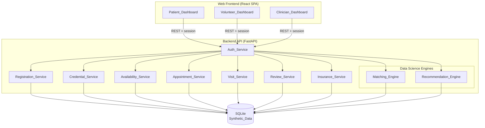
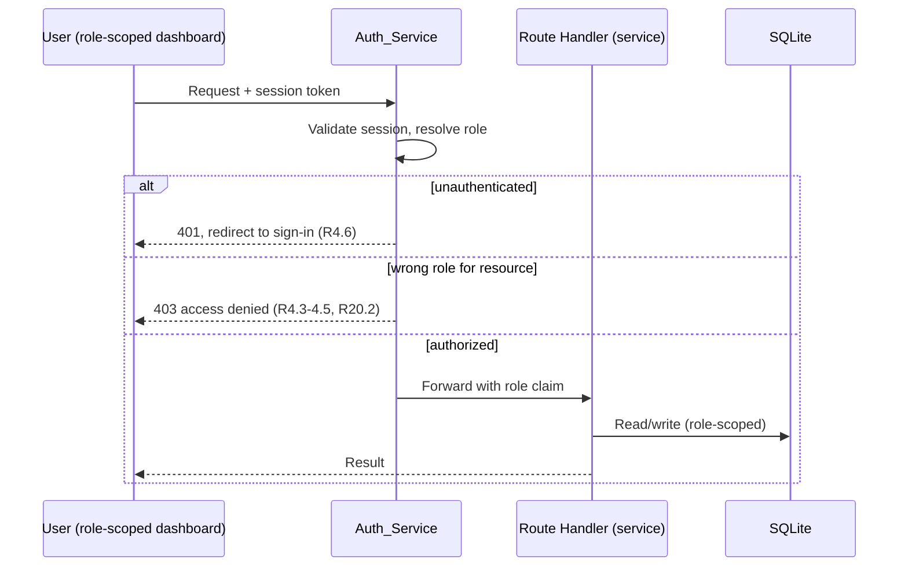
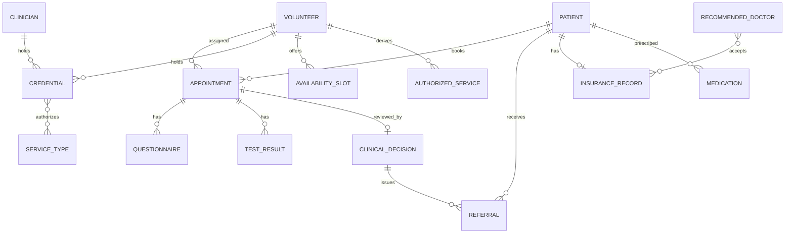
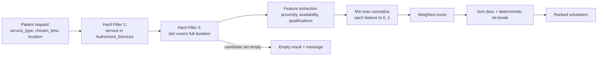
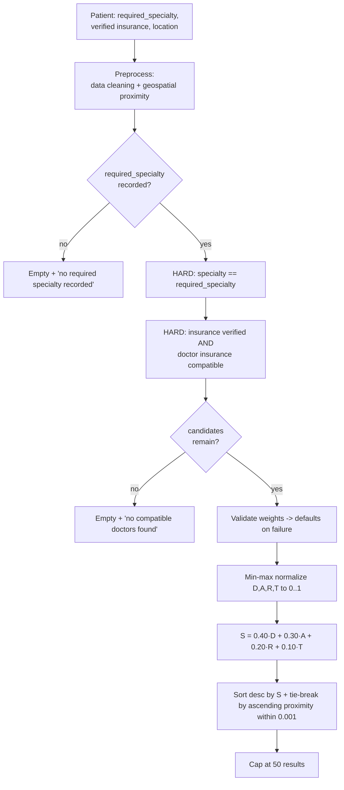
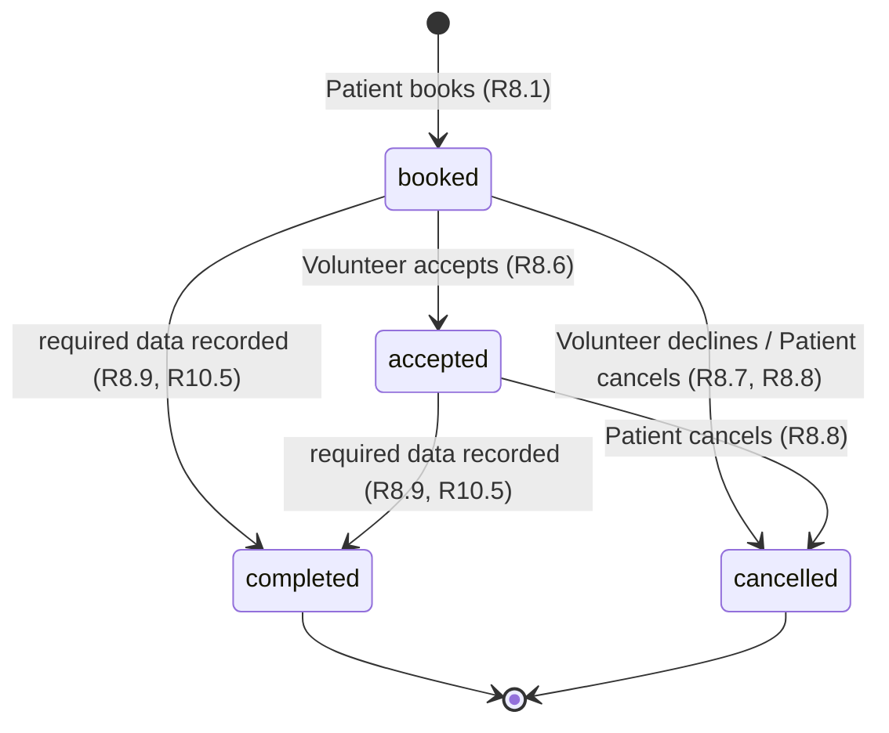

# Design Document

## Overview

CareConnect is a web platform that coordinates preventive at-home healthcare across three roles — Patient, Volunteer, and Clinician — while keeping a licensed Clinician in the clinical-decision loop at all times. The design centers on two data science capabilities: a patient-to-volunteer **Matching_Engine** and a weighted doctor **Recommendation_Engine**. Everything else in the system (registration, auth, credentials, availability, appointments, visits, review, insurance) exists to feed clean, trustworthy inputs into those two engines and to enforce the safety constraints that make the recommendations clinically and financially usable.

All records are **Synthetic_Data**. Privacy/HIPAA considerations are documented but not fully implemented, matching the hackathon scope in the requirements.

This design addresses every Essential and Important requirement (1–20). Stretch requirements (21 Notifications, 22 Live Prescriptions, 23 Demand Prediction) are explicitly marked **out of scope for the core build** in the relevant sections and in [Out-of-Scope and Stretch Features](#out-of-scope-and-stretch-features), so the hackathon team stays focused on a working end-to-end demo.

### Design Goals

1. **Safety by construction** — credential gating, specialty + insurance hard filters, consent gating, and display-only medications are enforced in the architecture, not left to UI discipline.
2. **Deterministic, testable DS** — both engines produce deterministic rankings with explicit tie-breaks so they can be validated with property-based tests.
3. **Hackathon-realistic** — a single pragmatic stack, a seedable synthetic dataset, and a scope that one small team can finish and demo (the Boston flu scenario).

### Key Design Decisions

| Decision | Choice | Rationale |
| --- | --- | --- |
| Stack | React (Vite) + FastAPI (Python) + SQLite | One language (Python) for the DS engines and API; React gives fast role-based dashboards; SQLite needs zero setup and seeds from a file. See [Architecture](#architecture). |
| DS in the backend | Matching/Recommendation run server-side in Python | NumPy-friendly normalization, deterministic, reusable by tests and API. |
| State machine | Appointment lifecycle as an explicit transition table | Requirement 8 enumerates valid transitions; a table makes illegal transitions impossible and trivially testable. |
| Auth | Session token + role claim, server-enforced per route | Requirement 4 requires role-based access denial, not just UI hiding. |
| Synthetic data | Seed script producing a fixed, deterministic dataset | Reproducible demos and deterministic tests. |

## Architecture

### High-Level Architecture

CareConnect is a classic three-tier web application: a React SPA with three role-scoped dashboards, a FastAPI backend exposing a REST API, and a SQLite data store. The two DS engines are plain Python modules invoked by the API layer.



Every request passes through `Auth_Service`, which authenticates the session and attaches the caller's role. Each route then enforces that the role is permitted (Requirement 4, 20.2). The DS engines are pure functions over data pulled from the store, which keeps them deterministic and unit/property-testable in isolation.

### Technology Stack

- **Frontend:** React + Vite + TypeScript, React Router for role-scoped routes. Lightweight (hackathon-friendly), fast dev loop.
- **Backend:** Python 3.11 + FastAPI + Pydantic. One language shared with the DS engines; Pydantic gives request validation (used heavily for the "missing required field" criteria).
- **DS libraries:** NumPy for vectorized normalization; pure-Python haversine for geospatial proximity. No ML framework needed for core (the engines are deterministic scoring, not learned models).
- **Data store:** SQLite via SQLAlchemy. Zero-config, file-based, seedable, transactional (needed for the concurrent-booking guard, Requirement 8.3).
- **Testing:** `pytest` + `hypothesis` for property-based testing of the engines and the state machine.

Rationale: a single deployable backend and a static SPA are the least moving parts that still demonstrate real role separation, real DS, and transactional safety — all achievable in a hackathon.

### Request Lifecycle and Access Control



## Components and Interfaces

Each component maps directly to a glossary entry. Interfaces are shown as representative operations (signatures abbreviated), not full REST specs.

### Registration_Service (R1, R2, R3, R20.4)

Creates accounts and assigns roles. Validates required fields and returns per-field errors. Records consent for Patients before booking is enabled.

```
register_patient(email, password, location, insurance, needs, pcp, consent) -> Patient | FieldErrors | AccountExists
register_volunteer(email, password, location, declared_credentials) -> Volunteer | FieldErrors
register_clinician(email, password, license_info) -> Clinician | FieldErrors
```

- Missing fields → reject listing **each** missing field (R1.2, R2.3, R3.3).
- Duplicate email → account-already-exists (R1.3).
- Patient location stored as `(lat, lng)` usable by both engines (R1.5, R2.4).
- Patient consent recorded at creation; booking checks it (R20.4, R8.5).

### Auth_Service (R4, R20.2)

Authenticates credentials, establishes a session carrying the role, and enforces per-dashboard/per-record access.

```
authenticate(email, password) -> Session(role) | AuthFailed
authorize(session, resource_role) -> Allow | Deny
```

- Valid creds → session; invalid → authentication-failed (R4.1, R4.2).
- Role grants its own dashboard, denies the other two (R4.3–4.5).
- Unauthenticated dashboard request → deny + redirect to sign-in (R4.6).
- Record access restricted to the caller's role (R20.2).

### Credential_Service (R5, R11.6, R13.2)

Records and verifies Volunteer/Clinician credentials and derives each Volunteer's **Authorized_Services** set.

```
record_credential(owner, credential) -> Credential(status=unverified)
verify_credential(credential, authority, timestamp) -> recompute authorized services
revoke_or_expire(credential) -> recompute authorized services
recompute_authorized_services(volunteer) -> Set[Service_Type]
is_clinician_license_verified(clinician) -> bool
```

- Verifying a Credential adds the Service_Types it authorizes and records status/authority/timestamp (R5.1).
- Unverified credential → its Service_Types excluded (R5.2).
- Vaccines/specimen/tests require an explicit verified credential; role alone never authorizes (R5.3).
- Recorded state/training/supervision conditions must **all** be satisfied or the Service_Type is excluded (R5.4).
- Revocation/expiration flips status to unverified and removes services authorized only by that credential (R5.6).
- Any status/condition change recomputes the set (R5.7).
- Unverified clinician license blocks Clinical_Decisions and prescriptions (R5.5, R11.6, R13.2).

`recompute_authorized_services` is the single source of truth — a pure function of a Volunteer's credentials and their conditions. This is what the Matching_Engine and Appointment_Service read, so authorization can never drift.

### Availability_Service (R6, R8.2, R8.7, R8.8)

Manages Volunteer availability slots and their assignment state.

```
add_slot(volunteer, start, end) -> Slot(available)
remove_slot(volunteer, slot) -> Unavailable | SlotHasAppointment
mark_unavailable(slot) / mark_available(slot)
slots_for_matching(volunteer) -> [Slot]
```

- Add marks available; remove (if unassigned) marks unavailable (R6.1, R6.2).
- Removing an assigned slot is rejected (R6.3).
- Exposes available slots to the Matching_Engine (R6.4).
- On booking, slot becomes unavailable before confirmation (R8.2); on decline/cancel it returns to available (R8.7, R8.8).

### Appointment_Service (R8, R10.5)

Owns the appointment **lifecycle state machine** and enforces booking preconditions. See [Appointment Lifecycle State Machine](#appointment-lifecycle-state-machine).

```
book(patient, volunteer, slot, service_type) -> Appointment(booked) | SlotUnavailable | NotAuthorized | ConsentRequired
transition(appointment, target_state, actor) -> Appointment | InvalidTransition
```

- Booking requires: available slot, service in Volunteer's current Authorized_Services, and recorded Patient consent (R8.1, R8.4, R8.5).
- Slot marked unavailable **transactionally** before booking-confirmed, closing the concurrent-booking race (R8.2, R8.3).
- Transitions restricted to the valid set; anything else → invalid-transition with state preserved (R8.6–R8.10).
- Completion is triggered by Visit_Service when required data is present (R10.5).

### Matching_Engine (R7) — DS Component 1

Ranks qualified Volunteers for a Patient's requested Service_Type and time. Detailed in [Data Science Component 1: Matching_Engine](#data-science-component-1-matching_engine).

```
match(patient, service_type, chosen_time) -> RankedList[Volunteer] | EmptyResult(message)
```

### Recommendation_Engine (R12.2, R15, R16) — DS Component 2

Applies mandatory hard filters then weighted scoring to recommend doctors. Detailed in [Data Science Component 2: Recommendation_Engine](#data-science-component-2-recommendation_engine).

```
recommend(patient, weights=DEFAULT) -> RankedList[Recommended_Doctor] (<=50) | EmptyResult(message)
```

### Insurance_Service (R14, R15.2)

Records and verifies insurance and reports compatibility only when verified.

```
verify_insurance(patient) -> verified | unverified(message)
compatibility(patient, doctor) -> compatible | incompatible | unknown
```

- New patient insurance starts unverified (R14.1); matches synthetic record → verified (R14.2); mismatch stays unverified with message (R14.3).
- While unverified, compatibility is **unknown** (R14.4) and the Recommendation_Engine must not assert compatibility (R15.4).
- Network acceptance does not guarantee service/home-visit coverage (R14.5) — surfaced as a display caveat.

### Visit_Service (R9, R10, R13.3, R13.4)

Shows authorized visit detail and captures questionnaires/test results, gated by authorization and appointment state.

```
visit_detail(volunteer, appointment) -> {service_type, location, authorized_services}
submit_questionnaire(volunteer, appointment, answers) -> Recorded | MissingRequired | Unauthorized | WrongState
submit_test_result(volunteer, appointment, result) -> Recorded | Unauthorized | WrongState
```

- Shows requested service + location and only the Volunteer's authorized services (R9.1, R9.2).
- Data entry allowed only for authorized services and only in `accepted` state; otherwise rejected with previously recorded data preserved (R9.3, R10.1–R10.4, R10.6).
- When all required questionnaire + test data for the service is present, asks Appointment_Service to transition to `completed` and queue for review (R10.5).
- Test_Result is information only and never sufficient to establish treatment (R10.7, R13.3, R13.4).

### Review_Service (R11, R12, R13)

Lets a verified Clinician review findings, record/approve decisions, and issue referrals; gates Patient visibility.

```
open_for_review(clinician, appointment) -> Findings | NotReadyForReview
record_decision(clinician, appointment, content) -> Stored | EmptyContent | NotVerified
approve_decision(clinician, appointment) -> Approved | NoDecisionToApprove
issue_referral(clinician, appointment, specialty) -> Referral (sets required specialty for Rec. Engine)
```

- Only `completed`+queued appointments open; others → not-ready-for-review (R11.1, R11.2).
- Non-empty decision stored and appointment marked reviewed (R11.3, R11.4); empty → rejected (R11.5).
- Unverified license → decision discarded, not stored (R11.6).
- Approval required before Patient can see a decision; no decision → nothing to approve (R11.7–R11.9).
- Referral records specialty and feeds it as the required specialty filter to the Recommendation_Engine (R12.1, R12.2).
- Medication display is verified-clinician-only and approval-gated; platform never derives prescriptions (R13).

### Dashboards (R17, R18, R19)

- **Patient_Dashboard:** upcoming appointments + states; request-match-and-book flow; approved decisions/referrals only; ranked Recommended_Doctors with proximity, specialty, insurance-compatibility status (R17).
- **Volunteer_Dashboard:** assigned appointments + states; availability management; accept + submit questionnaires/results; per-appointment only authorized services shown (R18).
- **Clinician_Dashboard:** review queue; view findings; record decisions/referrals; mark approved (R19).

Dashboards are presentation only; all rules live in the services behind them.

## Data Models

All records are Synthetic_Data (R20.1). Shown as logical entities; stored in SQLite via SQLAlchemy.



### Core entities

**Patient** — `id, email, password_hash, location{lat,lng}, insurance_id, needs[], pcp, role="patient", consent_given:bool, required_specialty?` (R1, R12.2, R20.4).

**Volunteer** — `id, email, password_hash, location{lat,lng}, role="volunteer", credentials[], authorized_services[] (derived)` (R2, R5).

**Clinician** — `id, email, password_hash, license:Credential, role="clinician"` (R3).

**Credential** — `id, owner_id, type, authorizes_service_types[], status:{unverified|verified}, verifying_authority?, verified_at?, expires_at?, conditions[]{kind, satisfied:bool}` (R5). `conditions` encodes state/training/supervision rules; a Service_Type is authorized only when status=verified and all conditions satisfied.

**Service_Type** — `id, name` (e.g., `vaccination`, `specimen_collection`, `diagnostic_test`), `required_tests[]`, `required_questions[]` used to decide completion (R10.5).

**Authorized_Service** — derived join `(volunteer_id, service_type_id)` recomputed by Credential_Service; never stored independently of a verified credential (R5.2, R5.6, R5.7).

**Availability_Slot** — `id, volunteer_id, start, end, status:{available|unavailable}, appointment_id?` (R6, R8.2).

**Appointment** — `id, patient_id, volunteer_id, slot_id, service_type_id, state:{booked|accepted|completed|cancelled}, queued_for_review:bool, reviewed:bool` (R8.10, R10.5, R11.4).

**Questionnaire** — `id, appointment_id, service_type_id, answers[]{question_id, value}, required_question_ids[]` (R10.1, R10.2).

**Test_Result** — `id, appointment_id, service_type_id, measurement, value, unit, synthetic:true` — information only (R10.3, R10.7, R13.3).

**Clinical_Decision** — `id, appointment_id, clinician_id, content(non-empty), reviewed:true, approved:bool, created_at` (R11.3–R11.9).

**Referral** — `id, clinical_decision_id, patient_id, specialty` — sets the Patient's `required_specialty` (R12).

**Recommended_Doctor / provider** — `id, name, specialty, location{lat,lng}, rating, open_slots_14d:int, accepted_insurance_ids[], one_way_travel_minutes` (R15, R16). Distinct from Clinician unless the same provider.

**Insurance_Record** — `patient_id or doctor_id, plan, network, verification_status:{unverified|verified}` (R14).

**Medication** — `id, patient_id, prescribing_clinician_id, name, approved:bool` — display-only, created only by a verified clinician, shown only when approved (R13).

### Enumerations

- `AppointmentState = {booked, accepted, completed, cancelled}`
- `VerificationStatus = {unverified, verified}`
- `InsuranceCompatibility = {compatible, incompatible, unknown}`

## Data Science Component 1: Matching_Engine

The Matching_Engine ranks Volunteers for a Patient's requested Service_Type at a chosen time (Requirement 7). It is a pure function over the current Authorized_Services, availability, and locations.

### Pipeline



### Hard filters (applied first, never overridden by score)

1. **Authorization filter** — include a Volunteer only if the requested Service_Type is in that Volunteer's current `authorized_services` (R7.1, R7.7). Because `authorized_services` is derived only from verified credentials, an unauthorized Volunteer can never appear regardless of other factors.
2. **Availability filter** — include a Volunteer only if they have an available slot that covers the **full duration** of the chosen time, i.e. `slot.start <= chosen.start AND slot.end >= chosen.end AND slot.status == available` (R7.2).

If the filtered candidate set is empty → return empty set + "no qualified volunteers are available" (R7.6).

### Feature extraction and normalization

For each surviving candidate, extract three raw features:

- **Proximity** `dist_km` = haversine distance between Patient and Volunteer lat/long.
- **Availability** `avail` = a measure of how free the Volunteer is around the chosen time (e.g., count of available slots in the surrounding window). Higher is better.
- **Qualifications** `qual` = strength of the Volunteer's authorization match for the requested service (e.g., number of satisfied verified credentials covering the service, higher is better).

Haversine distance (R1.5, R2.4 provide lat/long):

```
a = sin²(Δφ/2) + cos φ1 · cos φ2 · sin²(Δλ/2)
dist_km = 2 · R · atan2(√a, √(1−a))      # R = 6371 km
```

Normalize each feature to `0..1` with min-max over the candidate set, with **1.0 = most favorable**:

- Proximity is inverted (nearer is better): `D_norm = 1 − (dist − min)/(max − min)`.
- Availability and qualifications are direct: `x_norm = (x − min)/(max − min)`.
- **Degenerate case:** if all candidates share a feature value (max == min), assign `1.0` to every candidate for that feature (mirrors R16.3 and avoids divide-by-zero).

### Weighted score and ranking

`score = w_prox · D_norm + w_avail · avail_norm + w_qual · qual_norm`, with sensible defaults (e.g., `0.5 / 0.3 / 0.2`) that keep nearer and more-available Volunteers higher (R7.3, R7.4). Order by **descending** score (R7.4).

### Deterministic tie-break (R7.5)

When scores are equal, break ties in this order so output is fully deterministic:

1. Higher Authorized_Service match (`qual`), then
2. Nearer Proximity (smaller `dist_km`), then
3. Earliest available slot start.

### Guarantees

- Never returns an unauthorized Volunteer (hard filter 1 + credential-derived authorization).
- Never returns a Volunteer without a covering available slot.
- Output ordering is deterministic for any input.

## Data Science Component 2: Recommendation_Engine

The Recommendation_Engine recommends doctors for a Patient (Requirements 12.2, 15, 16). **Mandatory hard filters run first and a high score can never override them.**

### Pipeline



### Preprocessing (R16.9)

Before any scoring: clean provider Synthetic_Data (drop/repair malformed records, coerce types, bound ratings to a valid range) and compute geospatial Proximity (haversine distance from the Patient) for every provider. Normalization happens only after cleaning.

### Mandatory hard filters (R15 — never overridden by score)

Order matters: filters come before scoring (R15.3, R16.10).

0. **Required specialty must exist** — if the Patient has no recorded required specialty (only set via a Referral, R12.2), return empty + "no required specialty has been recorded" (R15.6).
1. **Exact specialty match** — include a doctor only if `doctor.specialty == patient.required_specialty` (R15.1).
2. **Verified insurance compatibility** — include a doctor only if the Patient's insurance status is **verified** AND Insurance_Service has recorded that doctor's accepted insurance as compatible (R15.2). While unverified, compatibility is presented as unverified and no doctor is asserted compatible (R15.4).

If no doctor passes both → empty + "no compatible doctors were found" (R15.5).

### Weighted scoring (R16.1)

`S = 0.40·D + 0.30·A + 0.20·R + 0.10·T`

where, after min-max normalization to `0..1` with **1.0 most favorable** (R16.2):

- **D** — normalized Proximity (inverse of distance; nearer → higher).
- **A** — normalized availability = count of open appointment slots within a **14-day window** (R16.4); more → higher.
- **R** — normalized doctor rating; higher → higher.
- **T** — normalized travel convenience = inverse of one-way travel time in minutes (R16.4); shorter → higher.

**Normalization direction:** D and T use the inverse direction (shorter distance / shorter travel time give higher normalized values); A and R are direct (R16.2).

**Degenerate case (R16.3):** when all candidates share the same value for a normalized factor, that factor is set to `1.0` for every candidate (prevents divide-by-zero and neutralizes a non-discriminating factor).

### Configurable, validated weights (R16.7, R16.8)

Weights may be supplied to replace the defaults, but only if **valid**: each weight in `[0.0, 1.0]` AND the four weights sum to `1.0 ± 0.001`. If configured weights are invalid, the engine falls back to the default weights `(0.40, 0.30, 0.20, 0.10)` and returns an invalid-weights message. Validation runs before scoring.

### Ranking, tie-break, and cap

- Order by **descending** S (R16.5).
- **Deterministic tie-break:** when two scores are within `0.001` of each other, break by **ascending Proximity** (nearer first) so ordering is deterministic (R16.6).
- Return **at most 50** Recommended_Doctors (R15.7).

### Guarantees

- Never returns a doctor whose specialty differs from the required specialty.
- Never asserts/returns an insurance-incompatible doctor, and never asserts compatibility while the Patient's insurance is unverified.
- Weights used for scoring always satisfy the normalization constraint (validated-or-default).
- Output ordering is deterministic; result count never exceeds 50.

## Appointment Lifecycle State Machine

The appointment state is always exactly one of `booked`, `accepted`, `completed`, `cancelled` (R8.10). Only the transitions enumerated in Requirement 8.9 are valid; any other requested transition is rejected, the current state is preserved, and an invalid-transition message is returned.



**Valid transition table** (the authoritative allow-list):

| From | To | Trigger |
| --- | --- | --- |
| booked | accepted | Volunteer accepts (R8.6) |
| booked | cancelled | Volunteer declines (R8.7) / Patient cancels (R8.8) |
| booked | completed | required data recorded (R8.9) |
| accepted | completed | required data recorded (R8.9, R10.5) |
| accepted | cancelled | Patient cancels (R8.8) |

Side effects bound to transitions:
- `booked → *` on decline/cancel and `accepted → cancelled` return the slot to **available** (R8.7, R8.8).
- `* → completed` queues the appointment for clinician review (R10.5).
- Any transition not in the table → rejected, state preserved, invalid-transition message (R8.9).

## Safety and Responsibility Constraints (Architectural Enforcement)

These constraints are enforced in the services and data model so they cannot be bypassed from the UI:

1. **Credential-gated authorization** — Volunteers can only be matched to, and record data for, Service_Types in their credential-derived `authorized_services`. Role alone never authorizes (R5.3, R7.1, R7.7, R9.3, R10.4).
2. **Specialty + insurance as hard constraints** — the Recommendation_Engine filters before scoring; score cannot resurrect a filtered-out doctor (R15.3, R16.10).
3. **Display-only medications** — medications are created only by a verified Clinician and shown only when approved; no component derives a prescription from a Test_Result, Questionnaire, or automation (R13).
4. **Insurance compatibility only when verified** — compatibility is `unknown` until the Patient's insurance is verified; the engine never asserts compatibility otherwise (R14.4, R15.4).
5. **Role-based data access** — every route checks the caller's role; records are restricted to permitted roles (R4, R20.2).
6. **Consent gate before booking** — booking is rejected unless the Patient's consent is recorded (R8.5, R20.4).
7. **Clinician license gate** — an unverified license blocks Clinical_Decisions and prescriptions (R5.5, R11.6, R13.2).

## End-to-End Flow: Boston Flu Demo Scenario

A Patient in Boston needs a flu vaccination at home; the full journey through both engines and the clinician loop:

```mermaid
sequenceDiagram
    participant P as Patient
    participant REG as Registration/Insurance
    participant M as Matching_Engine
    participant AP as Appointment_Service
    participant V as Volunteer (Visit_Service)
    participant C as Clinician (Review_Service)
    participant R as Recommendation_Engine

    P->>REG: Register (Boston location, insurance, consent) 
    REG-->>P: Patient created; insurance verified (R14.2)
    P->>M: Request match: vaccination @ chosen time
    M->>M: Hard filters (authorized + available) -> normalize -> score
    M-->>P: Ranked authorized volunteers (R7)
    P->>AP: Book top volunteer + slot (consent checked)
    AP->>AP: Slot -> unavailable (txn), appointment=booked (R8.1,R8.2)
    V->>AP: Accept -> accepted (R8.6)
    V->>V: Record questionnaire + flu test result (authorized, accepted) (R10)
    V->>AP: Required data complete -> completed + queued (R10.5)
    C->>C: Review findings, record decision, approve (R11)
    C->>R: Issue referral (specialty) -> sets required_specialty (R12)
    P->>R: View recommended doctors
    R->>R: HARD specialty+verified-insurance filter -> S=0.40D+0.30A+0.20R+0.10T -> rank, cap 50
    R-->>P: Ranked compatible specialists w/ proximity, specialty, insurance status (R16,R17.4)
```

## Error Handling

The system uses explicit, typed outcomes rather than silent failure. Every rejection preserves prior state and returns a specific message, matching the EARS criteria.

| Category | Handling | Requirements |
| --- | --- | --- |
| Validation (missing fields) | Reject; list **each** missing field | R1.2, R2.3, R3.3, R10.2 |
| Duplicate / conflict | Reject with specific message (account-exists, slot-unavailable) | R1.3, R8.3 |
| Authentication / authorization | 401 + redirect (unauthenticated); 403 (wrong role) | R4.2, R4.6, R4.3–4.5 |
| Credential / license gates | Reject, do not persist, return not-verified / not-authorized | R5.3, R5.5, R11.6, R13.2 |
| Hard-filter empties | Return empty set + descriptive message (no volunteers / no doctors / no specialty) | R7.6, R15.5, R15.6 |
| Invalid state transition | Reject, **preserve current state**, invalid-transition message | R8.9 |
| Unauthorized visit data | Reject, **retain previously recorded data**, unauthorized-service message | R9.3, R10.4 |
| Wrong appointment state for data | Reject, retain data, return current state | R10.6 |
| Concurrent booking race | Transactional slot lock; loser gets slot-unavailable | R8.2, R8.3 |
| Invalid scoring weights | Fall back to defaults + invalid-weights message | R16.8 |
| Insurance unverifiable | Keep unverified, compatibility unknown, message | R14.3, R14.4 |

Principles: fail closed on safety gates; preserve state on rejection; return actionable messages; use DB transactions for the booking race.

## Correctness Properties

*A property is a characteristic or behavior that should hold true across all valid executions of a system — essentially, a formal statement about what the system should do. Properties serve as the bridge between human-readable specifications and machine-verifiable correctness guarantees.*

These properties were derived by converting testable acceptance criteria into universally quantified statements. Redundant criteria were consolidated during prework reflection (e.g., the specialty, insurance, and "never overridden by score" criteria collapse into one recommendation hard-filter invariant).

### Property 1: Matching never returns an unauthorized volunteer

*For any* set of volunteers and any patient request for a Service_Type, every volunteer in the Matching_Engine result has that Service_Type in their credential-derived Authorized_Services, regardless of their score on any other factor.

**Validates: Requirements 7.1, 7.7**

### Property 2: Matching only returns volunteers with a covering available slot

*For any* set of volunteers and any chosen time window, every volunteer in the Matching_Engine result has an available slot whose start is at or before the chosen start and whose end is at or after the chosen end.

**Validates: Requirements 7.2**

### Property 3: Matching features normalize into range

*For any* candidate set, every normalized matching feature (proximity, availability, qualifications) lies within the closed interval [0.0, 1.0], and when all candidates share a feature value that feature is 1.0 for every candidate.

**Validates: Requirements 7.3**

### Property 4: Matching ranking is ordered and deterministic

*For any* candidate set, the Matching_Engine result is ordered by non-increasing weighted score, ties are broken by the defined order (higher qualification, then nearer proximity, then earliest slot), and the resulting order is identical for any permutation of the input.

**Validates: Requirements 7.4, 7.5**

### Property 5: Matching returns empty exactly when no volunteer qualifies

*For any* candidate set in which no volunteer satisfies both the authorization and availability hard filters, the Matching_Engine returns an empty result set with a no-qualified-volunteers message.

**Validates: Requirements 7.6**

### Property 6: Authorized_Services reflect only verified, condition-satisfied credentials

*For any* set of a volunteer's credentials, a Service_Type is in the volunteer's Authorized_Services if and only if some credential that authorizes it is verified and has all recorded conditions satisfied.

**Validates: Requirements 5.1, 5.2, 5.3, 5.4, 5.6, 5.7**

### Property 7: Appointment transitions follow only the valid transition graph

*For any* appointment and any requested transition, the transition succeeds if and only if it is one of (booked→accepted, booked→cancelled, booked→completed, accepted→completed, accepted→cancelled); otherwise the current state is preserved and an invalid-transition message is returned. The recorded state is always exactly one of booked, accepted, completed, or cancelled.

**Validates: Requirements 8.6, 8.7, 8.8, 8.9, 8.10**

### Property 8: Booking requires recorded consent

*For any* patient, a booking attempt succeeds only if that patient's consent to participate is recorded; otherwise it is rejected with a consent-required message and no appointment is created.

**Validates: Requirements 8.5, 20.4**

### Property 9: Completion occurs exactly when required visit data is present

*For any* appointment in the accepted state, it transitions to completed and is queued for review if and only if every required questionnaire question and every required Test_Result for its Service_Type has been recorded.

**Validates: Requirements 10.5**

### Property 10: Clinical decisions are visible to the patient exactly when approved

*For any* stored Clinical_Decision, it is available to the associated Patient if and only if the Clinician has marked it approved.

**Validates: Requirements 11.8, 11.9**

### Property 11: Displayed medications are verified-prescribed and approved

*For any* set of medication records, every medication shown on the Patient_Dashboard was prescribed by a Clinician whose license is verified and has been marked approved by that Clinician.

**Validates: Requirements 13.1, 13.5**

### Property 12: Insurance compatibility is unknown while insurance is unverified

*For any* patient whose insurance verification status is unverified, the reported insurance compatibility for every Recommended_Doctor is unknown, and no doctor is asserted as insurance-compatible.

**Validates: Requirements 14.4, 15.4**

### Property 13: Recommendation never returns a doctor failing a hard filter

*For any* provider set and any patient, every doctor in the Recommendation_Engine result has a specialty equal to the patient's required specialty and passes the verified-insurance compatibility filter, regardless of that doctor's computed score.

**Validates: Requirements 15.1, 15.2, 15.3, 16.10**

### Property 14: Recommendation returns empty exactly when filters pass no one

*For any* patient with no recorded required specialty, the Recommendation_Engine returns empty with a no-required-specialty message; and *for any* provider set in which no doctor passes both hard filters, it returns empty with a no-compatible-doctors message.

**Validates: Requirements 15.5, 15.6**

### Property 15: Recommendation result size is capped at 50

*For any* provider set, the Recommendation_Engine returns at most 50 Recommended_Doctors.

**Validates: Requirements 15.7**

### Property 16: Recommendation factors normalize into range with degenerate handling

*For any* candidate set (including cleaned, out-of-range, or malformed input data), each normalized factor D, A, R, T lies within [0.0, 1.0] with 1.0 most favorable and the inverse direction applied to distance and travel time, and when all candidates share a factor's value that factor is 1.0 for every candidate.

**Validates: Requirements 16.1, 16.2, 16.3, 16.9**

### Property 17: Recommendation ranking is ordered and deterministic

*For any* filtered candidate set, results are ordered by non-increasing score S, ties within 0.001 are broken by ascending proximity, and the resulting order is identical for any permutation of the input.

**Validates: Requirements 16.5, 16.6**

### Property 18: Scoring weights always normalize

*For any* supplied weight configuration, the weights actually used for scoring each lie within [0.0, 1.0] and sum to 1.0 within a tolerance of 0.001; a configuration failing either check is replaced by the default weights (0.40, 0.30, 0.20, 0.10) and an invalid-weights message is returned.

**Validates: Requirements 16.7, 16.8**

## Testing Strategy

The system is validated with a **dual approach**: property-based tests for the universal invariants of the two DS engines and the state machine, and example/integration tests for role access, concurrency, dashboards, and the negative prescription guarantees.

### Property-Based Testing

PBT is appropriate here because the Matching_Engine, Recommendation_Engine, credential derivation, and the appointment state machine are pure functions with clear input/output behavior and large input spaces (varying locations, ratings, slot windows, credential sets, transition sequences). They have genuine "for all inputs X, property P(X) holds" statements.

- **Library:** `hypothesis` (Python), with custom strategies generating synthetic patients, volunteers, credentials, providers, slots, and transition sequences — including degenerate and malformed cases (all-equal factors, out-of-range ratings, empty candidate pools).
- **Iterations:** each property test runs a minimum of **100 iterations**.
- **Implementation:** each of Properties 1–18 is implemented by a **single** property-based test; no PBT framework is implemented from scratch.
- **Tagging:** each test is tagged with a comment in the form
  `# Feature: careconnect, Property {number}: {property_text}`
  referencing the design property it validates.
- **Determinism checks:** ranking determinism (Properties 4, 17) is verified by shuffling the input order and asserting identical output order.

### Example-Based and Integration Tests

Used where behavior does not vary meaningfully with input, or where the target is infrastructure/UI:

- **Role-based access (R4, R20.2):** example tests — each role is granted its own dashboard and denied the other two; unauthenticated requests redirect to sign-in.
- **Concurrent booking (R8.2, R8.3):** integration test simulating two bookings of the same slot in one transaction window; exactly one succeeds, the other gets slot-unavailable.
- **No automated prescribing (R13.2, R13.4):** example tests asserting that prescription creation from a non-verified-clinician path, a Test_Result, a Questionnaire, or an automated component is rejected and not persisted.
- **Validation messaging (R1.2, R2.3, R3.3, R10.2):** example tests asserting each missing required field is named.
- **Dashboards (R17–R19):** component/snapshot and example tests for composition and state display.
- **Insurance verification matching (R14.2, R14.3):** example tests against the seeded synthetic insurance records.

### Synthetic Data for Tests and Demo

A deterministic seed script generates the synthetic dataset (patients, volunteers with credentials, providers, insurance records) used by both the demo and the integration tests, ensuring reproducible runs (R20.1).

## Out-of-Scope and Stretch Features

To keep the hackathon build focused on a working end-to-end demo, the following requirements are **out of scope for the core build**. They are acknowledged in the architecture so the design can extend to them later, but no core deliverable depends on them:

- **Automated Notifications (R21, Stretch):** optional. Hooks exist conceptually at the `accepted` transition and at decision approval, but no notification transport is built for the core.
- **Live Prescriptions and Clinical Integrations (R22, Stretch):** out of scope. The core keeps medications display-only and local; external clinical-system transmission is not implemented.
- **Healthcare Demand Prediction (R23, Stretch):** out of scope for core. The forecast over synthetic appointment history by geographic area is an optional add-on that does not block the primary care journey.

Privacy/HIPAA-style protections (R20.3) are documented as requirements but not fully implemented, consistent with the hackathon scope.
